# Oracle Cloud Setup — Your Simple TODO

**For:** Kushal (first time using Oracle Cloud)
**Goal:** Get the backend running on your two Oracle VMs.
**Rule:** Do the steps in order. Tick the box when done.

---

## 📊 Where we are (big picture)

```mermaid
flowchart LR
    A["1. Create VMs<br/>✅ DONE"] --> B["2. Lock SSH door<br/>⏸️ DEFERRED<br/>(option B)"]
    B --> C["3. Make passwords<br/>✅ DONE"]
    C --> D["4. Install Docker<br/>✅ DONE"]
    D --> E["5. Secrets on the VMs<br/>✅ DONE"]
    E --> F["6. Ship image +<br/>database ready<br/>✅ DONE"]
    F --> H["7. Open private<br/>DB ports<br/>✅ DONE"]
    H --> K["8. Start app stack<br/>✅ DONE (healthy)"]
    K --> J["9. Open public<br/>port 80<br/>✅ DONE"]
    J --> I["10. Verify from<br/>the internet<br/>✅ DONE — LIVE 🎉"]
    I --> G["11. HTTPS padlock<br/>(domain optional)<br/>⏳ LATER"]
```



### Simple picture of what you have

```
                 INTERNET
                    │
        ┌───────────┴───────────┐
        │                       │
   ┌────▼─────┐           ┌─────▼────┐
   │  VM-1    │  private  │  VM-2    │
   │ DATABASE │◄─────────►│  APP     │
   │ Postgres │  network  │ Go + web │
   │ + Redis  │           │  server  │
   └──────────┘           └──────────┘
   140.238.240.2          130.210.26.64
   (public IP)            (public IP)
```

- **VM-1** = the "filing cabinet" (database). Nobody on the internet should reach it except you via SSH.
- **VM-2** = the "shop counter" (the app). Later it will be the only one open to the world (port 80/443).

**Already verified ✅**
- Both VMs exist and are running.
- Your SSH keys work (I logged in to both).
- Database/Redis ports are safely closed to the internet.
- **Docker 29 + Compose installed on both VMs** (2 GB swap added, firewalls set, VM-1's DB/Redis ports opened only to the private subnet).
- You generated the 4 passwords ✅
- `.env` files installed on both VMs (`chmod 600`, no placeholders) ✅
- App image built (78.5 MB) and loaded on VM-2 ✅
- Database stack healthy on VM-1: Postgres + durable Redis ✅
- Migrations applied: **41** (82 tables) ✅
- Migration policy: `run_migrations.sh --production` only (all schema migrations + CORE seeds); `seeds/mock` never runs in production ✅
- nginx config fixed (now proxies to the `app` service, not localhost) ✅
- Private ports 5432 + 6381 opened to the private subnet only ✅
- App stack running on VM-2: Go app **healthy** + cache + nginx ✅
- App connected to Postgres, routes responding (401 = auth required, working) ✅
- Public port 80 opened to the internet ✅
- **Live and verified from the internet:** `http://130.210.26.64` 🎉
- External scan confirms DB/Redis/app ports remain closed to the world ✅

---

## ⏸️ Task 1 — Lock the SSH door — **DEFERRED by your choice**

You chose **Option B**: keep port 22 open to the internet, protected by SSH keys only
(password login is disabled, so nobody can get in without your private key).

- [x] Decision made: keep as-is for now
- [ ] Revisit later (when everything works) → either restrict to your IP or set up Tailscale

> Original instructions are still below if you ever want to do it.

### 1.1 Find your IP address

Open a terminal on your laptop and run (the `-4` is important — it forces IPv4):

```bash
curl -4 -s ifconfig.me
```

You will get something like `49.36.12.34`. **Write it down.**

> **Why this IP?** Your laptop and phone share ONE public IPv4 address through your WiFi router. Oracle sees that router address when you SSH, so that's what we allowlist.
>
> ⚠️ **IPv6 does not work here** — if the command shows something like `2409:4090:...` (with colons), it's IPv6. Re-run with `-4`.
>
> ⚠️ **This IP can change** when your router reboots or your ISP rotates it. If SSH suddenly stops working, just re-run this command and update the rule again (it's a 2-minute fix, nothing is broken).

### 1.2 Change the rule in Oracle Console

Click this path in the Oracle Cloud website:

1. Click the **☰ menu** (top-left corner)
2. Click **Networking** → **Virtual Cloud Networks**
3. Click your **VCN** (the network name)
4. Click **Subnets** → click your **subnet**
5. Click the **security list name** (usually "Default Security List for ...")
6. Click the **Ingress Rules** tab
7. Find the row where the **Destination Port Range** is `22`
8. Click the **⋮ (three dots)** at the end of that row → **Edit**
9. Change **Source CIDR** from `0.0.0.0/0` to **`<your-ip>/32`**
   - Example: `49.36.12.34/32`
10. Click **Save**

### 1.3 Check that it worked

- [ ] Rule saved
- [ ] I can still SSH (don't close your terminal until you tested!)

Test from your laptop:

```bash
ssh -i ~/.ssh/oci_vm1 opc@140.238.240.2
```

If it connects → ✅ done. Type `exit` to leave.

> ⚠️ **Heads up:** If your home internet IP changes later (some ISPs do this), SSH will stop working. Fix = do step 1.2 again with the new IP.
>
> ⚠️ **Do NOT touch** the rules for ports 5432 / 6379 / 8080 — leaving them empty is correct.

---

## ✅ Task 2 — Make the passwords (5 minutes)

**Why?** The app needs secret passwords. We must NOT reuse the test ones from the code.

Open a terminal on your laptop and run each line. **Copy the output into a password manager** (Bitwarden, 1Password, KeePass — anything).

```bash
# 1. Encryption key (protects courier/payment keys stored in DB)
openssl rand -hex 32

# 2. Login token signing key (JWT)
openssl rand -hex 32

# 3. Database password
openssl rand -base64 24

# 4. Redis password (used by both cache + queue Redis)
openssl rand -base64 24
```

Write them down like this:

| Name | Your value (keep private!) |
|---|---|
| `ENCRYPTION_KEY` | |
| `JWT_SECRET` | |
| `DB_PASSWORD` | |
| `CACHE_PASSWORD` = `KV_PASSWORD` | |

- [ ] Generated all 4 values
- [ ] Saved them somewhere safe (password manager)
- [ ] **Did not** paste them into chat, git, or screenshots

> 🔐 These go **only** into `.env` files on the VMs (step 5). Never into the repo.

---

## ✅ Task 2.5 — Put the secrets on the VMs — **DONE** ✅

I prepared a script that does all the boring parts. Run it from the repo folder:

```bash
cd "/home/kushal/Work/Personal Codes/Ecommerce/ecommerce-be"
./deploy/setup-secrets.sh
```

What happens:

1. It checks SSH to both VMs (should pass — I just tested them)
2. It asks for the 4 values one by one — **typing is invisible** (no stars, that's normal)
3. It asks for the public URL — **just press Enter** to accept `http://130.210.26.64`
4. It writes `~/ecommerce-data/.env` on VM-1 and `~/ecommerce-app/.env` on VM-2
5. It deletes the local temporary copies

You will see something like:

```
Checking SSH access...
VM-1 private IP: 10.0.0.208

Paste each value when asked (input is hidden)...
DB_PASSWORD:              ← type your DB password, press Enter
CACHE_PASSWORD (also used as KV_PASSWORD):
JWT_SECRET:
ENCRYPTION_KEY:
PUBLIC_API_BASE_URL [http://130.210.26.64]:   ← just press Enter

Copying .env files to the VMs...
Done. Both .env files are in place (mode 600).
```

- [x] Ran `./deploy/setup-secrets.sh` successfully
- [x] Saw `Done. Both .env files are in place`

> 🚫 **Do not paste the values into this chat.** The script handles them directly.

---

## 🔴 Task 2.6 — Open the private database ports (2 minutes) — 👉 **DO THIS NOW**

**Why?** The app on VM-2 must talk to the database on VM-1. Right now OCI blocks that connection, so the app cannot start yet.

**This is safe:** the rules only allow traffic from *inside your own private network* (`10.0.0.0/24`). The internet still cannot reach the database.

### Steps in Oracle Console

1. **☰ menu** → **Networking** → **Virtual Cloud Networks**
2. Click your **VCN** → **Subnets** → click your **subnet**
3. Click the **security list name** ("Default Security List for ...")
4. Click **Ingress Rules** → **Add Ingress Rules**
5. Add rule 1:

| Field | Value |
|---|---|
| Stateless | **No** (leave unchecked) |
| Source Type | **CIDR** |
| Source CIDR | `10.0.0.0/24` |
| IP Protocol | **TCP** |
| Source Port Range | *(leave empty)* |
| Destination Port Range | `5432` |

6. Click **+ Another Ingress Rule** and add rule 2 — same values except **Destination Port Range** = `6381`
7. Click **Add Ingress Rules**

### Check

- [ ] Rule for TCP `5432` from `10.0.0.0/24` added
- [ ] Rule for TCP `6381` from `10.0.0.0/24` added

> When both are added → message me **"rules added"**.
>
> ✅ You did this — VM-2 now reaches VM-1, and the app stack is running healthy.

---

## ✅ Task 2.7 — Open public port 80 — **DONE** ✅

**Why?** The app is running on VM-2, but the Oracle network firewall still blocks the world from reaching it on port 80. This is the *only* rule that makes it public.

### Steps in Oracle Console (same place as Task 2.6)

1. **☰ menu** → **Networking** → **Virtual Cloud Networks**
2. Your **VCN** → **Subnets** → your **subnet**
3. Click the **security list name**
4. **Ingress Rules** → **Add Ingress Rules**
5. Fill:

| Field | Value |
|---|---|
| Stateless | **No** (unchecked) |
| Source Type | **CIDR** |
| Source CIDR | `0.0.0.0/0` |
| IP Protocol | **TCP** |
| Source Port Range | *(leave empty)* |
| Destination Port Range | `80` |
| Description | `Public HTTP` |

6. Click **Add Ingress Rules**

> ⚠️ `0.0.0.0/0` means "the whole internet" — that's intended and safe for port 80 only. **Never** use `0.0.0.0/0` for 5432/6379/6381/8080.

### Check

- [x] Rule for TCP `80` from `0.0.0.0/0` added

> ✅ Done — verified from the internet.

---

## 🟡 Task 2.8 — Reserve static public IP (optional, 2 min per VM)

**Why?** Right now the public IPs are *ephemeral* — they survive reboots but change if the VM is ever terminated and re-created. Reserving keeps them forever.

**Use Method A — it keeps the current address.**

1. **☰ menu** → **Compute** → **Instances** → click **VM-2**
2. **Attached VNICs** → click the **VNIC name**
3. **IP Addresses** tab → find the **Public** row (`130.210.26.64`)
4. **⋮ (three dots)** → **Edit**
5. Public IP type → **Reserved public IP** → **Create new reserved public IP**
6. Name it (e.g. `ecommerce-api-ip`) → **Update / Save**
7. Repeat for **VM-1** (`140.238.240.2`)

Verify after each:

```bash
ssh -i ~/.ssh/oci_vm2 opc@130.210.26.64 'echo ok'
curl -s -o /dev/null -w "%{http_code}\n" http://130.210.26.64/   # expect 400 (app answering)
```

> ⚠️ The address must stay **identical**. If the console shows a different IP, stop and tell me.
> ⚠️ Do one VM at a time; expect a ~5–10s network blip.
> 💰 Reserved IPs are free while attached to a running instance.

- [ ] VM-2 IP reserved (still `130.210.26.64`)
- [ ] VM-1 IP reserved (still `140.238.240.2`)

> ❌ Do **not** use Networking → IP Management → Reserve (Method B): it creates a *new* address and changes your public IP.

---

## ✅ Task 3 — (Optional, later) A name for the server

**Short answer: you do NOT need to buy a domain.** The app deploys and works over a plain IP address. A domain only adds the HTTPS padlock. Pick ONE of these, whenever you're ready:

```
OPTION A — IP only (works today, free)
   http://130.210.26.64  →  your app
   ✅ nothing to do   ❌ no HTTPS padlock

OPTION B — free auto-name (works today, free)
   https://130-210-26-64.sslip.io  →  your app
   ✅ real HTTPS   ❌ odd-looking URL

OPTION C — subdomain of the domain you own (chosen 2026-11-22)
   https://api.vitrapay.io  →  your app
   ✅ real HTTPS   ✅ clean URL   ✅ your other site is NOT affected
   (just one DNS record: A  api  →  130.210.26.64)
```

**What each option can do:**

| Works over IP + HTTP (Option A) | Needs HTTPS (Option B or C) |
|---|---|
| Backend tests with curl / Postman | Frontends (Vercel) calling the API |
| Server-to-server calls | Razorpay webhooks (require HTTPS) |
| Internal/admin testing | Secure cookies in production |

- [x] Picked: **C — `api.vitrapay.io`**
- [ ] Added the DNS record `A  api  →  130.210.26.64`
- [ ] Certbot + nginx TLS + `PUBLIC_API_BASE_URL=https://api.vitrapay.io` (spec 014 T052)

**HTTPS is still pending.** The backend currently serves HTTP on the IP; the domain decision does not change the running stack until T052.

---

## 🎉 It's live — what's optional next

| Task | Who | Notes |
|---|---|---|
| HTTPS with `api.vitrapay.io` | me + you | Adds the padlock; see Task 3 / spec 014 T052 |
| Nightly database backups | me | `pg_dump` cron + retention |
| Boot-volume backup policy | you (console) | ~2 min in Oracle Console |
| Docker log rotation | me | Prevents disk fill |
| Manual GitHub deploy + build visibility | me | The `workflow_dispatch` feature you asked about |
| Restrict SSH / Tailscale | you + me | Optional hardening |

You **do not** need to run any commands for these — just pick which ones you want next.

---

## 🛠️ Day-2 operations & hardening (spec 014 Phase 7–8)

Everything below lives in `deploy/`. Items marked **operator** need the OCI console.

### Backups (T045, T046, T049)

- Nightly `pg_dump` (gzip, integrity-checked, 7-day retention):

  ```bash
  ssh -i ~/.ssh/oci_vm1 opc@140.238.240.2
  cd ~/ecommerce-data/backup && ./install-backup.sh   # cron 03:00 UTC
  ./pg-backup.sh                                       # run one now
  ```

  Dumps land in `~/ecommerce-data/backups/`. Restore + restore-drill steps: `deploy/vm1-data/backup/RESTORE.md`.

- **operator** — Boot-volume backup policy (both VMs): OCI console → **Compute → Instances → instance → Boot volumes → Backup policies** → attach a schedule (weekly full + daily incremental fits the Always Free allowance). Confirm a policy is attached on **both** instances.

### Log rotation (T047)

Both compose files set `json-file` logging (`max-size=10m`, `max-file=3`) per
container via a top-level `x-logging` anchor, so Docker logs cannot fill the
50 GB boot volume. Applied with the next `docker compose up -d`.

### Monitoring (T048)

```bash
cd ~/monitor && ./install-monitor.sh   # 5-minute cron
./health-check.sh                      # prints health=ok / health=DEGRADED
```

Checks container health, root-disk headroom (<85%), and swap. A metrics stack
(Prometheus + node_exporter + cAdvisor) stays a future option.

### Secret rotation (T051)

Per-secret runbook and restart order: `deploy/ROTATION.md`.

### TLS — `api.vitrapay.io` (T052) — **operator (DNS) + deploy**

1. **operator** — add DNS `A api → 130.210.26.64`.
2. Run the certbot/nginx steps in `deploy/vm2-app/TLS.md`, then set
   `PUBLIC_API_BASE_URL=https://api.vitrapay.io`.

### Real client IPs (T053)

`TRUSTED_PROXIES=172.16.0.0/12` in `~/ecommerce-app/.env` (already in the Config
`prod` file) makes the IP rate limiter trust the nginx hop's `X-Forwarded-For`.
Ships with the next app image.

### SSH hardening (T054) — **operator**

Restrict ingress TCP `22` to `<your-ip>/32` (see Task 1 above), or move SSH to
Tailscale and close `22`.

### Image tagging & rollback (T056)

`deploy/ship-image.sh` tags `:<branch>-<sha>` + `:latest` and preserves the
running image as `:previous`. Roll back with
`IMAGE_TAG=previous docker compose up -d app`.

### Automated deploy (T057–T060)

Manual-trigger GitHub Actions workflow `.github/workflows/deploy-oracle.yml`;
setup, secrets, and build-visibility details in `deploy/GITHUB-DEPLOY.md`.

---

## 🔒 Production migration policy (T072) — enforced

Production migrations run **only** through:

```bash
# VM-1, from ~/ecommerce-data
docker compose --profile tools run --rm migrate   # -> run_migrations.sh --production
```

`--production` = all schema migrations + CORE seeds (`migrations/seeds/core/`).

> `--production` is a **runner mode** meaning "schema + CORE seeds, never mock data" — it is not the environment name. The deployed environment is `dev`.

**Forbidden in production:** `migrations/seeds/mock/` (demo users/products) and
the runner modes `--all` (the default), `--seed`, `--seed-mock`, `--force-seed`,
and `--reset`. The repo-root `docker-compose.yml` migrate service runs `--all`
and must **never** be pointed at production.

## ✅ Post-migration verification (T073)

After every production migration, run on VM-1:

```sql
-- 1. every recorded migration succeeded
SELECT count(*) FILTER (WHERE status='SUCCESS') AS ok,
       count(*) FILTER (WHERE status<>'SUCCESS') AS bad
FROM schema_migration;                     -- expect bad = 0

-- 2. reference data present (non-zero)
SELECT (SELECT count(*) FROM role)             AS roles,
       (SELECT count(*) FROM plan)             AS plans,
       (SELECT count(*) FROM country)          AS countries,
       (SELECT count(*) FROM storage_provider) AS storage_providers,
       (SELECT count(*) FROM payment_gateway)  AS payment_gateways,
       (SELECT count(*) FROM courier_provider) AS courier_providers;

-- 3. ZERO mock data
SELECT count(*) FROM "user"
 WHERE email='admin@ecommerce.com' OR email LIKE '%@example.com';               -- expect 0
SELECT count(*) FROM seller_profile
 WHERE business_name IN ('Tech Gadgets Pro','Fashion Forward','Home & Living Store'); -- expect 0
```

## ⚙️ Configuration from `Zatu-ecom/Config` (T071/T074)

Non-secret config lives in `Zatu-ecom/Config` (`<env>/backend.env`) — the
`local/` and `dev/` files, `required/*.keys`, and the `validate`/`render` scripts
are committed there (see its README). The app repo keeps only `deploy/.env.example`
for reference and secrets never live in either repo. Render the server `.env`
from Config + secrets:

```bash
# from a Config repo checkout, with secrets exported in the environment
DB_PASSWORD=... JWT_SECRET=... ENCRYPTION_KEY=... CACHE_PASSWORD=... \
  scripts/render-backend-env.sh prod ~/ecommerce-app/.env
```

Until this is adopted, the server-side `.env` files remain the source of truth;
their key set matches `Config/dev/backend.env`.

---

## 🚫 Things NOT to do

| Don't | Why |
|---|---|
| Put real passwords in this file, git, or chat | Anyone with repo access gets them |
| Open ports 5432 / 6379 / 6380 / 6381 / 8080 to `0.0.0.0/0` | Exposes DB/Redis to the whole internet |
| Run `dnf install ...` on these small VMs | 1 GB RAM boxes crash — the script uses a safe method |
| Run `--all`, `--seed`, `--seed-mock`, or `--reset` in production | Loads demo users/products (`seeds/mock`) or drops data — use `--production` only |
| Delete or stop the VMs | Everything lives on their disks |

---

## 📋 Master checklist

| # | Task | Who | Status |
|---|---|---|---|
| 1 | Create 2 VMs | you | ✅ done |
| 2 | SSH keys working | you | ✅ done |
| 3 | Port scan verified | me | ✅ done |
| 4 | Lock SSH to your IP | you | ⏸️ deferred (option B chosen) |
| 5 | Generate 4 secrets | you | ✅ done |
| 6 | Run bootstrap (Docker/swap) | me | ✅ done |
| 7 | Put `.env` files on VMs | you | ✅ done |
| 8 | Build + ship app image | me | ✅ done |
| 9 | Start DB stack + run migrations | me | ✅ done (41 applied) |
| 10 | Open private ports 5432 + 6381 | you | ✅ done |
| 11 | Start app stack on VM-2 | me | ✅ done (all healthy) |
| 12 | Open public port 80 | you | ✅ done |
| 13 | Verify from the internet | me | ✅ done — **LIVE** 🎉 |
| 13b | Reserve static public IP (Task 2.8) | you | ✅ done |
| 14 | Server name + HTTPS (`api.vitrapay.io`) | later | ⏳ pending 014 T052 |
| 15 | Manual GitHub deploy (pick branch, no auto-push) | me | ⬜ future (014 tasks T057–T060) |
| 16 | `/version` endpoint for build visibility | me | ❌ dropped (Actions history + deploy record cover it) |
| 17 | Frontend deployment (storefront + seller dashboard, free host) | me + you | 📄 spec written: `specs/015-frontend-cloud-deployment/spec.md` |

**Deployment is live → `http://130.210.26.64`**

---

## 📦 Current deployment record (as of 2026-11-22)

| Item | Value |
|---|---|
| Branch / code | `014-backend-cloud-deployment` (built from local working tree) |
| Image | `ecommerce-backend:latest` (78.5 MB, linux/amd64); `deploy/ship-image.sh` now also tags `:<branch>-<sha>` + `:previous` |
| Deploy method | Manual scripts from laptop (no CI/CD yet); manual-trigger workflow tracked in `deploy/GITHUB-DEPLOY.md` |
| Database | PostgreSQL 16 + 41 migrations applied (`--production` runner mode; CORE seeds only) |
| Environment | `dev` (`APP_ENV=dev`) — the Oracle VMs are the dev environment; there is no prod |
| Public URL | `http://130.210.26.64` (HTTP only) — target `https://api.vitrapay.io` |
| TLS / HTTPS | Not yet (needs the `api.vitrapay.io` DNS record + certbot — Task 3 / T052) |
| Config | `Zatu-ecom/Config` populated (`local/` + `dev/`, `required/`, `scripts/`); app repo keeps `deploy/.env.example` |
| Day-2 ops | Backup + restore, monitoring, rotation, log rotation artifacts under `deploy/` (see Day-2 section) |

> ℹ️ Calling `http://130.210.26.64/` in a browser returns
> `400 CORRELATION_ID_REQUIRED` — that is the app answering, **not** an outage.
> Real API calls need `X-Correlation-ID` (and auth headers where required).
